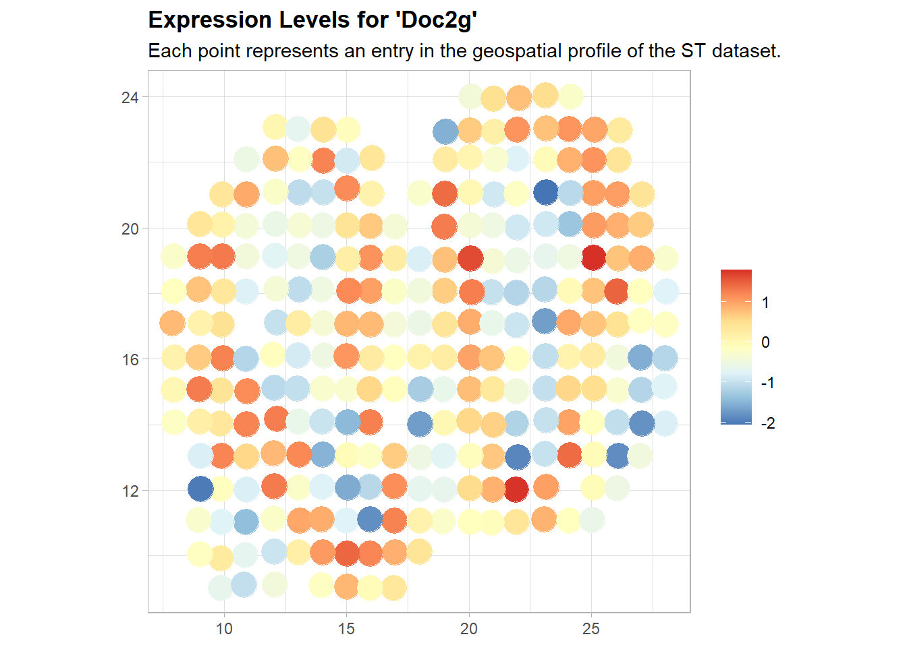

SV Gene Detection
===============================

This page documents the five SV gene detection methods implemented natively in ``boost``: BOOST-GP, BOOST-MI, BinSpect, SPARK, and SpatialDE. Each function analyzes one gene. The wrappers for the other seven methods benchmarked in STAr (nnSVG, SPARK-X, MERINGUE, Trendsceek, Seurat Moran's I, SOMDE, and SpaGCN) are described in :doc:`new_methods`, and a multi-gene workflow is given in :doc:`tutorial`.

The examples below use gene ``Doc2g`` from the Mouse Olfactory Bulb dataset (filtered and normalized as in :doc:`preprocessing`). In STAr, a gene is called an SVG if its Bayes factor is greater than 150 (BOOST-GP and BOOST-MI) or if its Benjamini-Hochberg adjusted p-value across all analyzed genes is less than 0.05 (other methods). The single-gene p-values shown below therefore need to be adjusted for multiple testing in a genome-wide analysis (see ``svg.select()`` in :doc:`tutorial`).

::

    abs_expr <- count[, 'Doc2g']

BOOST-GP
------------------------------------------

BOOST-GP (Bayesian mOdeling Of Spatial Transcriptomics data via Gaussian Process) model requires the expression counts for one gene (one column of the original count matrix :math:`Y`) and the location information :math:`T` as inputs. The estimated size factor is also an input for it. 

::

    result_boost_gp <- BOOST.GP(abs_expr, sample_info, size.factor = size_factor, gene.name = 'Doc2g', n.iter = 3000)
    
    print(result_boost_gp)
    ## 
    ## Call:
    ## BOOST.GP(abs.expr = abs_expr, spots = sample_info, size.factor = size_factor, 
    ##     gene.name = "Doc2g", n.iter = 3000)
    ## 
    ## Model: BOOST-GP 
    ## 
    ## Parameters:
    ##                                   Estimate Std. Error Lower 95% CI Upper 95% CI
    ## Dispersion                           10.99      3.400         6.90        21.71
    ## Normalized gene expression levels    25.69     15.030         6.04        58.97
    ## Kernel                                0.68      0.035         0.61         0.74
    ## 
    ## Bayes Factor in favor of a spatially variable gene: 1.9e+11
    ## p-value: 0

The outputs include the estimates of dispersion and kernel scale parameters in BOOST-GP model and also the mean normalized gene expression levels across spots. The Bayes factor is the criterion for determining whether a gene is an SV gene. If the Bayes factor is greater than 150, we infer that this gene is an SV gene (the printed p-value is a convenience transformation of the Bayes factor and is not used in STAr). In this example, Bayes factor is extremely large, indicating strong evidence that gene 'Doc2g' is an SV gene.

BOOST-MI (BOOST-Ising)
------------------------------------

Before applying BOOST-MI (Bayesian mOdeling Of Spatial Transcriptomics data via a modified Ising model; the function ``BOOST.MI()`` is the current name of ``BOOST.Ising()``), several data pre-processing steps are required. Following STAr, genes with zero counts in more than 80% of spots are first excluded (``filter.st(..., method = "BOOST-MI")``). Then, we binarize the TSS-normalized expression levels using Gaussian mixture clustering with the ``binarize.st`` function.

::

    binary_expr <- binarize.st(normalized_count, 'Doc2g', cluster.method =  "GMC")

Instead of sample_info matrix, BOOST-MI method requires the neighbor information of sample points. We apply get.neighbors function to generate the neighbor information. Sample points for this data are located on a square lattice, so each spots has at most 4 neighbors. 

::

    neighbor_info <- get.neighbors(sample_info, n.neighbors = 4, method = "distance")

BOOST-MI requires the binarized expression levels for one gene and the neighbor information as inputs. 

::

    result_boost_ising <- BOOST.MI(binary_expr, neighbor_info, gene.name = 'Doc2g')

    print(result_boost_ising)
    ## 
    ## Call:
    ## BOOST.MI(bin.expr = binary_expr, neighbor.info = neighbor_info, 
    ##     gene.name = "Doc2g")
    ## 
    ## Model: BOOST-MI 
    ## 
    ## Parameters:
    ##                       Prior Mean Prior S.D. Estimate Std. Error Lower 95% CI
    ## First-Order Intensity          1       2.50     0.93      0.136         0.68
    ## Interaction                    0       0.33    -0.75      0.098        -0.96
    ##                       Upper 95% CI
    ## First-Order Intensity         1.21
    ## Interaction                  -0.57
    ## 
    ## Bayes Factor in favor of an attraction pattern: 1e+10
    ## Bayes Factor in favor of a repulsion pattern: 0

The outputs include the estimates of the two parameters of the BOOST-MI model, with the default priors used in STAr (:math:`\omega_0 \sim N(1, 2.5^2)` and :math:`\theta \sim N(0, (1/3)^2)`, 10,000 iterations with the first half as burn-in). A negative interaction parameter indicates an attraction pattern and a positive one a repulsion pattern. The Bayes factor is the criterion for determining whether a gene is an SV gene: if it is greater than 150, we infer that the input gene is an SV gene. For real datasets, STAr reports the larger of the two Bayes factors (``result_boost_ising$measures$BF.max``). In this example, the Bayes factor for the attraction pattern is :math:`1\times 10^{10}`, indicating strong evidence that gene 'Doc2g' is an SV gene. 

BinSpect
----------------------------------
Similar pre-processing steps are required for BinSpect (Binary Spatial Extraction of genes from Giotto), including binarization and generating neighbor information. Like BOOST-MI, BinSpect requires the binarized expression level for one gene and the neighbor information as inputs. Note that ``binSpect()`` is a re-implementation of the BinSpect test using the lattice neighbor network from ``get.neighbors()``; the results shown on the STAr website were obtained with the Giotto implementation (Delaunay network), so the p-values may differ slightly. 

::

    result_binspect <- binSpect(binary_expr, neighbor_info, do.fisher.test = FALSE, gene.name = 'Doc2g')

    print(result_binspect)
    ## 
    ## Call:
    ## binSpect(bin.expr = binary_expr, neighbor.info = neighbor_info, 
    ##     do.fisher.test = FALSE, gene.name = "Doc2g")
    ## 
    ## Model: BinSpect 
    ## 
    ## Contingency Table for Classified Edges:
    ##     0   1
    ## 0 298 144
    ## 1 144 356
    ## 
    ## Odds ratio in favor of a spatially-variable pattern: 5.12
    ## p-value in favor of a spatially-variable pattern: <0.001

The outputs include the contingency table summarized from the neighbor pairing binarized expresssion. P-value is the criteria for determining whether a gene is an SV gene or not. If the output p-value is less than 0.05, we infer that it is an SV gene. In this example, the p-value is less than 0.001, indicating strong evidence that gene 'Doc2g' is an SV gene. 

SPARK
----------------------------

Like BOOST-GP, SPARK (Spatial PAttern Recognition via Kernels) requires the expression counts for one gene (one column of the original count matrix :math:`Y`), the location information :math:`T`, and the estimated size factor as inputs.

::

     result_SPARK <- SPARK(abs_expr, sample_info, size.factor = size_factor, gene.name = 'Doc2g')
     
     print(result_SPARK)
     ## 
     ## Call:
     ## SPARK(abs.expr = abs_expr, spots = sample_info, size.factor = size_factor, 
     ##     gene.name = "Doc2g")
     ## 
     ## Model: SPARK 
     ## 
     ## Summary:
     ##     GSP1   COS1    GSP2 COS2 GSP3 COS3 GSP4    COS4 GSP5    COS5
     ##  2.6e-09 0.0045 6.1e-05    1 0.12 0.24  0.6 3.9e-11 0.73 2.8e-11
     ## 
     ## p-value in favor of a spatially-variable pattern: <0.001

The outputs include the p-values under different kernel function settings. Combined p-value is the criteria for determining whether a gene is an SV gene or not. If the output combined p-value is less than 0.05, we infer that it is an SV gene. In this example, the combined p-value is less than 0.001, indicating strong evidence that gene 'Doc2g' is an SV gene. 

SpatialDE
----------------------------

SpatialDE method assumes the expression data are normally distributed. So instead of TSS normalization method, we need to use log-VST choice to normalize the data. This normalization method includes stabilizing the variance of counts data (the approximate Anscombe transformation in Supplementary Notes S2 of the STAr paper) and regressing out the effect of library size.

::

    normalized_count_log_vst <- normalize.st(count, scaling.method = "log-VST")

    norm_expr <- normalized_count_log_vst[, 'Doc2g']

SpatialDE requires the normalized expression counts for one gene and the location information :math:`T` as inputs.

::

   result_spatialde <- SpatialDE(norm_expr, sample_info, gene.name = 'Doc2g')
   
   print(result_spatialde)
   ## 
   ## Call:
   ## SpatialDE(norm.expr = norm_expr, spots = sample_info, gene.name = "Doc2g")
   ## 
   ## Model: SpatialDE 
   ## 
   ## Summary:
   ##      g   n  FSV   l BIC
   ##  Doc2g 260 0.57 1.1 609
   ## 
   ## p-value in favor of a spatially-variable pattern: <0.001

The outputs include the fraction of expression variance (FSV), characteristic length scale in the kernel function, and Bayesian information criterion (BIC). P-value is the criteria for determining whether a gene is an SV gene or not. If the output p-value is less than 0.05, we infer that it is an SV gene. In this example, the p-value is less than 0.001, indicating strong evidence that gene 'Doc2g' is an SV gene. 

Plot SV Gene
------------------------

Using ``st.plot``, we can visualize the expression pattern for genes. In the ``st.plot`` function, absolute counts, normalized or binarized expression levels, combined with the location information, are the inputs. If the input is binarized expression levels, set parameter binary to be TRUE. 

::

    st.plot(norm_expr, sample_info, gene.name = 'Doc2g', binary = FALSE, log.expr = FALSE)
    

