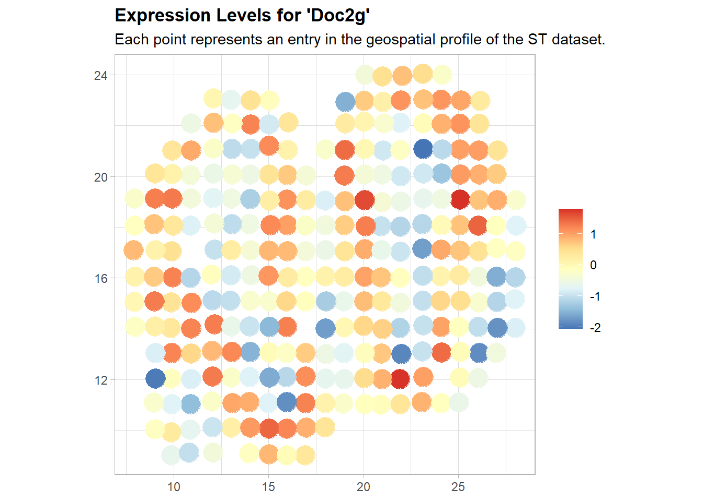

Step-by-step Tutorial
=====================

This tutorial walks through a complete SVG analysis with ``boost`` on the Mouse Olfactory Bulb data (replicate 11) from the `Spatial Transcriptomics Arena (STAr) <https://lce.biohpc.swmed.edu/star/>`_:

#. downloading and loading a standardized STAr dataset;
#. spot- and gene-level filtering with the method-specific criteria used in STAr;
#. size-factor estimation, normalization, and preparation of method-specific inputs;
#. SVG detection with multiple methods;
#. converting the method outputs into a standardized result table;
#. method-appropriate SVG selection;
#. rank aggregation with GEO and MC2;
#. visualization of the spatial expression patterns of detected SVGs.

All ``boost`` functions use a **spot-by-gene** count matrix (spots in rows, genes in columns, gene names as column names) and a spot-by-2 coordinate matrix in the same spot order.

1. Download and load the data
-----------------------------

Each standardized STAr dataset contains the raw count matrix, the spatial coordinates, the gene names, and the gene identifiers as ``.csv`` files (see :doc:`loaddata`)::

    library(boost)

    url <- paste0("https://lce.biohpc.swmed.edu/star/download/st/",
                  "mouse_olfactory_bulb_st/processed_data/",
                  "mouse_olfactory_bulb_replicate_11.zip")
    download.file(url, destfile = "mob.zip", mode = "wb")
    unzip("mob.zip")

    count <- as.matrix(read.csv("mouse_olfactory_bulb_replicate_11.count.csv"))
    spots <- as.matrix(read.csv("mouse_olfactory_bulb_replicate_11.loc.csv")[, 1:2])
    gene_name <- read.csv("mouse_olfactory_bulb_replicate_11.gene_name.csv")
    colnames(count) <- gene_name$x

    dim(count)   # 262 spots x 16218 genes
    dim(spots)   # 262 spots x 2 coordinates

The same data are also shipped with the package as ``data(mob)`` (objects ``mob`` and ``mob.spots``).

2. Filter spots and genes
-------------------------

STAr filters genes with the criterion given in the original publication of each method; when no criterion is given, genes expressed in fewer than 10% of spots are removed (Section 3.4 and Supplementary Notes S1 of the STAr paper). ``svg.filter.criteria()`` lists the criteria and ``filter.st()`` applies them::

    svg.filter.criteria()
    ##      method min.total min.percentage min.spots               source
    ## 1  BOOST-GP        10            0.1         0 original publication
    ## 2  BOOST-MI        10            0.2         0 original publication
    ## 3     SPARK        10            0.1         0 original publication
    ## 4 SpatialDE        10            0.1         0         STAr default
    ## 5  BinSpect        10            0.1         0         STAr default
    ## 6    SpaGCN        10            0.0         3 original publication
    ## 7   default        10            0.1         0         STAr default

    methods  <- c("BOOST-GP", "BOOST-MI", "BinSpect", "SPARK", "SpatialDE")
    filtered <- lapply(methods, function(m) filter.st(count, spots, method = m))
    names(filtered) <- methods

    sapply(filtered, function(f) dim(f$count))

Spots with fewer than ten total counts are removed for every method; BOOST-MI keeps genes expressed in at least 20% of spots, and BOOST-GP, SPARK, SpatialDE, and BinSpect keep genes expressed in at least 10% of spots.

3. Prepare method-specific inputs
---------------------------------

The methods use different representations of the data: BOOST-GP and SPARK model raw counts with size factors, BOOST-MI and BinSpect use binarized expression and a spatial neighbor network, and SpatialDE uses normalized expression::

    ## BOOST-GP and SPARK: raw counts + total-sum-scaling size factors
    sf_gp    <- get.size.factor(filtered[["BOOST-GP"]]$count, estimation.method = "TSS")
    sf_gp    <- sf_gp / mean(sf_gp)
    sf_spark <- get.size.factor(filtered[["SPARK"]]$count, estimation.method = "TSS")
    sf_spark <- sf_spark / mean(sf_spark)

    ## BOOST-MI: TSS-normalized expression, binarized by Gaussian mixture clustering
    norm_mi <- normalize.st(filtered[["BOOST-MI"]]$count, scaling.method = "TSS")

    ## BinSpect: log TSS-normalized expression, binarized by k-means
    norm_bs <- log(normalize.st(filtered[["BinSpect"]]$count, scaling.method = "TSS") + 1)

    ## SpatialDE: variance-stabilized expression adjusted for library size
    ## ("log-VST" is the approximate Anscombe transformation in Supplementary Notes S2)
    norm_de <- normalize.st(filtered[["SpatialDE"]]$count, scaling.method = "log-VST")

    ## spots of ST data lie on a square lattice: four neighbors per spot
    neighbors <- get.neighbors(filtered[["BOOST-MI"]]$spots, n.neighbors = 4,
                               method = "distance")

For 10x Visium data, whose spots lie on a hexagonal lattice, use ``n.neighbors = 6``.

4. Detect SVGs with multiple methods
------------------------------------

BOOST-GP, BOOST-MI, BinSpect, SPARK, and SpatialDE analyze one gene at a time, so a genome-wide analysis loops over genes. Because BOOST-GP and BOOST-MI rely on posterior sampling, a genome-wide run takes several hours; to try out the workflow quickly, start with a small panel of genes, here including the known layer markers *Penk*, *Kctd12*, and *Nrgn* (Supplementary Section S3.2), and replace ``genes`` by ``colnames(count)`` for the full analysis::

    genes <- c("Penk", "Kctd12", "Nrgn", "Doc2g", "Apoe", "Ptn",
               "Nrf1", "Zbtb5", "Ccnl1", "Bbs1")

    run_gene <- function(g) {
      out <- list()
      if (g %in% colnames(filtered[["BOOST-GP"]]$count))
        out$gp <- as.svg.result(BOOST.GP(filtered[["BOOST-GP"]]$count[, g],
                                         filtered[["BOOST-GP"]]$spots,
                                         size.factor = sf_gp, gene.name = g,
                                         n.iter = 1000))
      if (g %in% colnames(norm_mi))
        out$mi <- as.svg.result(BOOST.MI(binarize.st(norm_mi, g, cluster.method = "GMC"),
                                         neighbors, gene.name = g))
      if (g %in% colnames(norm_bs))
        out$bs <- as.svg.result(binSpect(binarize.st(norm_bs, g, cluster.method = "k-means"),
                                         get.neighbors(filtered[["BinSpect"]]$spots, 4),
                                         gene.name = g))
      if (g %in% colnames(filtered[["SPARK"]]$count))
        out$sp <- as.svg.result(SPARK(filtered[["SPARK"]]$count[, g],
                                      filtered[["SPARK"]]$spots,
                                      size.factor = sf_spark, gene.name = g))
      if (g %in% colnames(norm_de))
        out$de <- as.svg.result(SpatialDE(norm_de[, g], filtered[["SpatialDE"]]$spots,
                                          gene.name = g))
      do.call(rbind, out)
    }

    results <- do.call(rbind, lapply(genes, run_gene))
    rownames(results) <- NULL

The other seven methods benchmarked in STAr (nnSVG, SPARK-X, MERINGUE, Trendsceek, Seurat Moran's I, SOMDE, and SpaGCN) analyze all genes at once through wrappers that call the original software, which must be installed separately (see :doc:`installation` and :doc:`new_methods`). They return the same standardized columns and can be combined with the results above::

    flt <- filter.st(count, spots)                 # default STAr criterion
    sparkx <- SPARK.X(flt$count, flt$spots)       # SPARK-X, option = "mixture"
    head(sparkx)

5. Standardize the results
--------------------------

``as.svg.result()`` converts each single-gene fit into one row of a common table, and the wrappers return the same columns::

    head(results)
    ##   gene   method    score score_type       pvalue padj
    ## 1 Penk BOOST-GP 1.90e+11         BF           NA   NA
    ## 2 Penk BOOST-MI 1.00e+10         BF           NA   NA
    ## 3 Penk BinSpect 5.31e+00     pvalue 0.000000e+00   NA
    ## 4 Penk    SPARK       NA     pvalue 1.110223e-16   NA
    ## ...

For BinSpect, ``score`` is the odds ratio of the contingency table.

The table keeps each method's native evidence measure: Bayes factors for BOOST-GP and BOOST-MI and p-values for the other methods. For BOOST-MI, the larger of the Bayes factors for the attraction and repulsion patterns is reported, as on the STAr website (use ``as.svg.result(fit, bf = "attraction")`` for the attraction pattern only). Bayes factors and p-values are not interchangeable, so they are never converted into a common score.

6. Select SVGs
--------------

``svg.select()`` applies the criteria used in STAr: a Bayes factor greater than 150 for BOOST-GP and BOOST-MI, and a Benjamini-Hochberg adjusted p-value below 0.05 for the other methods. Adjusted p-values are computed within each method across all analyzed genes, so the adjustment is only meaningful when all genes of interest are analyzed together::

    results <- svg.select(results)

    ## number of SVGs per method
    tapply(results$is.svg, results$method, sum)

    ## SVGs detected by each method
    split(results$gene[results$is.svg], results$method[results$is.svg])

7. Aggregate rankings with GEO and MC2
--------------------------------------

GEO and MC2 combine the gene rankings of BOOST-GP, BOOST-MI, BinSpect, SPARK, and SpatialDE (SpaGCN is excluded in STAr because its domain-guided rankings are not directly comparable). Genes are ranked within each method (larger Bayes factors and smaller p-values rank higher), the union of the top-:math:`K` genes from each method receives an aggregated rank, and the remaining genes with at least one result are assigned the current maximum rank plus one. STAr uses :math:`K = 1000`::

    svg.rank.table(results)                     # within-method ranks

    geo <- svg.aggregate(results, K = 1000, method = "GEO")
    mc2 <- svg.aggregate(results, K = 1000, method = "MC2")
    head(geo)
    head(mc2)

When fewer than :math:`K` genes are analyzed, :math:`K` is reduced to the number of genes.

8. Visualize detected SVGs
--------------------------

``st.plot()`` shows the spatial expression pattern of a gene. Here we plot the layer markers *Penk* and *Kctd12* (cf. Figure 4 of the STAr paper)::

    norm_plot <- normalize.st(flt$count, scaling.method = "log-VST")

    st.plot(norm_plot[, "Penk"], flt$spots, gene.name = "Penk", log.expr = FALSE)
    st.plot(norm_plot[, "Kctd12"], flt$spots, gene.name = "Kctd12", log.expr = FALSE)

    ## binarized expression used by BOOST-MI
    st.plot(binarize.st(norm_mi, "Penk", cluster.method = "GMC"),
            filtered[["BOOST-MI"]]$spots, gene.name = "Penk", binary = TRUE)

Recommended workflow for a new dataset
--------------------------------------

#. Check that the expression matrix and the spatial coordinates contain the same spots in the same order (spots in rows).
#. Filter spots and genes with ``filter.st()``, using the criterion of each method (``svg.filter.criteria()``).
#. Prepare raw, normalized, and/or binarized expression according to each method's requirements; choose ``n.neighbors = 4`` for square lattices (ST) and ``6`` for hexagonal lattices (10x Visium).
#. Run one or more SVG detection methods on all genes; use the STAr simulation results under settings that resemble your data (sparsity, spatial pattern, number of locations, and computing time) to choose methods.
#. Convert the results with ``as.svg.result()`` and select SVGs with ``svg.select()``.
#. Compare the methods and, if desired, obtain a consensus ranking with ``svg.aggregate()``.
#. Visualize representative top-ranked genes with ``st.plot()``.
#. Record package versions (``sessionInfo()``), random seeds, filtering criteria, and method parameters.
